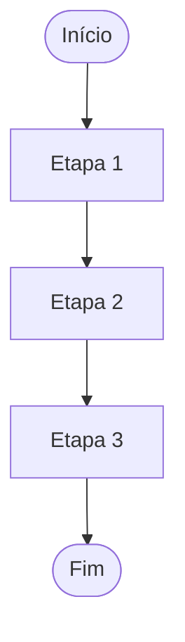
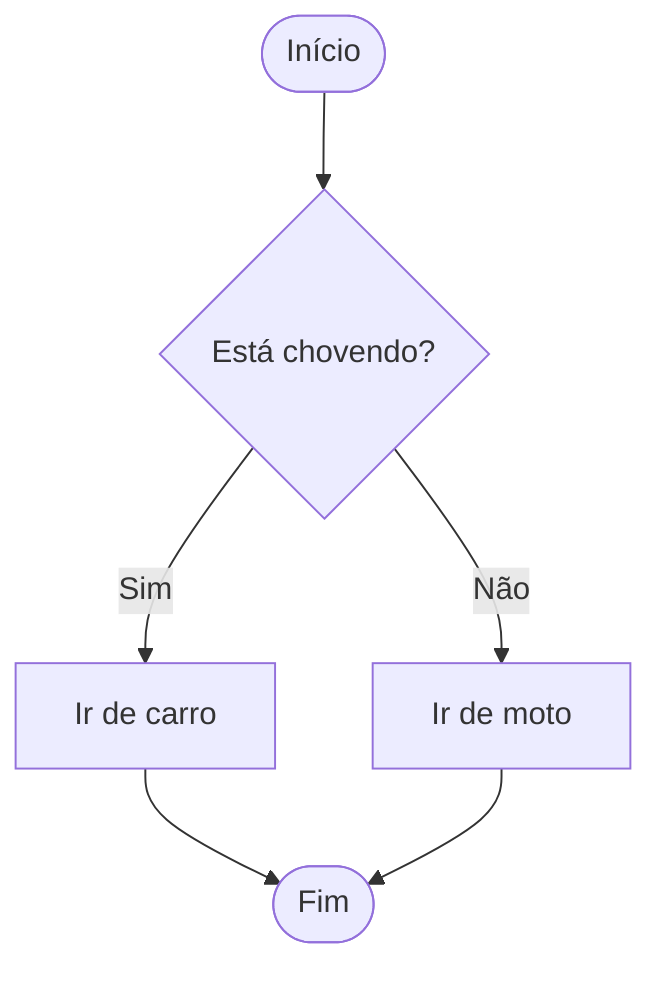
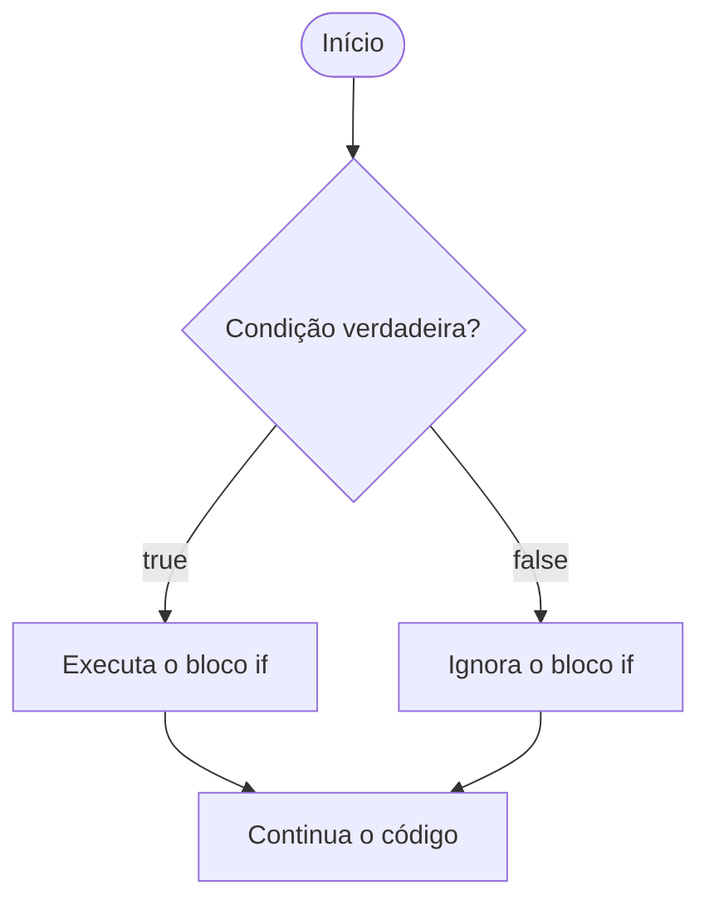
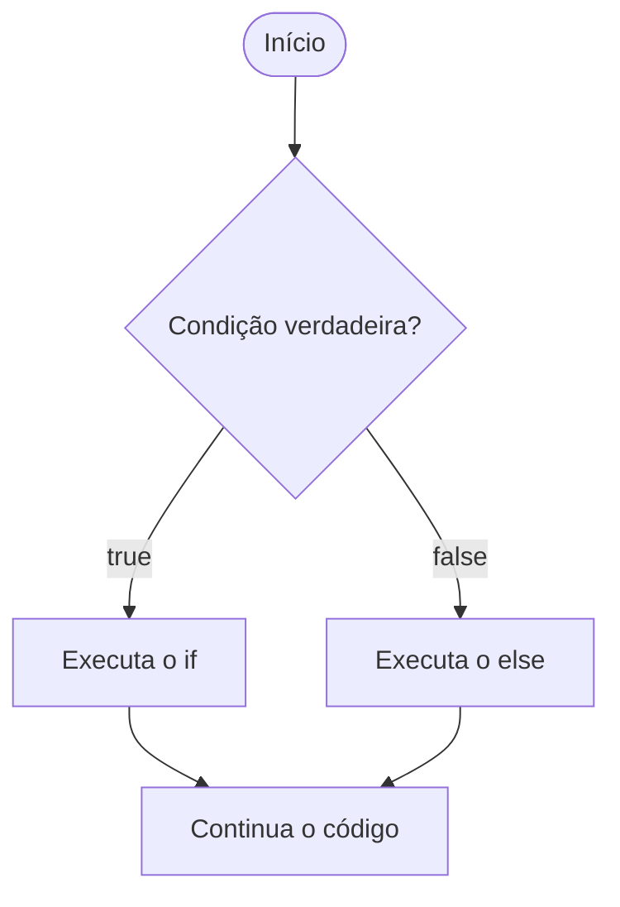
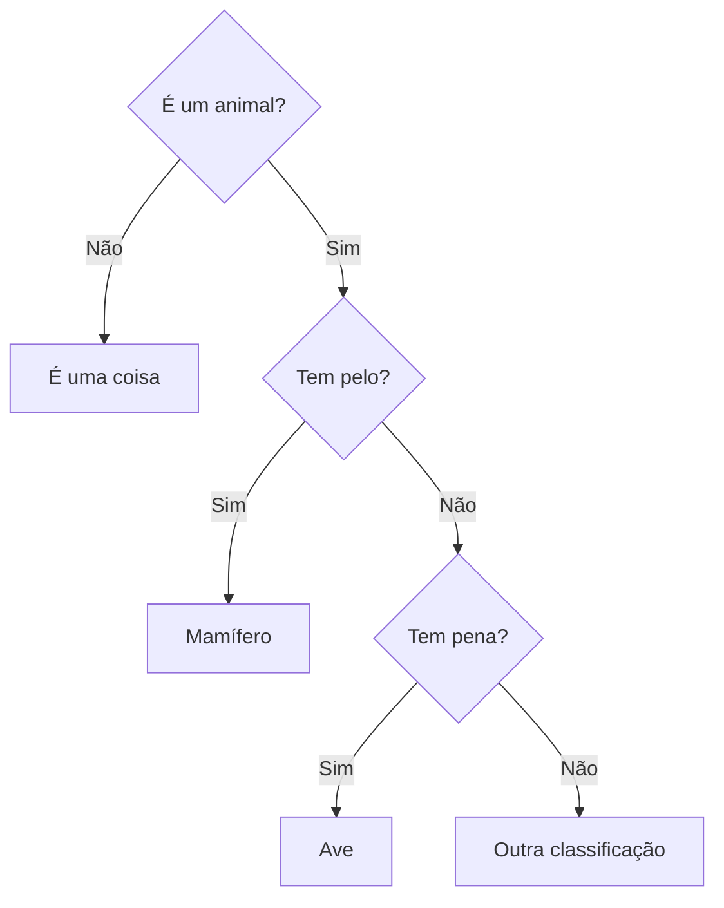

# 💻 Condicionais em JavaScript — Estruturas de Controle

## Link para aula: https://canva.link/5qvn4tg3v48770j

> UC — Desenvolver Algoritmos

As **condicionais** permitem que um programa tome decisões e execute diferentes ações de acordo com uma condição.

---

## 1. Relembrando: operadores de comparação

Comparadores são operadores utilizados para fazer perguntas ao código. O resultado de uma comparação é sempre um **booleano**:

- `true` → verdadeiro;
- `false` → falso.

| Operador | Significado | Exemplo | Resultado |
|---|---|---|---|
| `>` | Maior que | `20 > 18` | `true` |
| `<` | Menor que | `20 < 18` | `false` |
| `>=` | Maior ou igual | `18 >= 18` | `true` |
| `<=` | Menor ou igual | `10 <= 10` | `true` |
| `===` | Igualdade estrita | `"Ana" === "Ana"` | `true` |
| `!==` | Desigualdade estrita | `"1234" !== "1234"` | `false` |

```javascript
let idade = 20;
console.log(idade >= 18); // true
console.log(idade < 18);  // false
```

> Atenção: `=` atribui um valor; `===` compara valor e tipo.

---

## 2. Condicionais na vida real 🐱

Tomamos decisões diariamente, mesmo sem perceber. A lógica é: **SE algo acontecer, ENTÃO execute uma ação.**

As ilustrações das páginas 7 a 12 da aula apresentam exemplos com gatinhos:

| Situação | Condição | Ação se verdadeira | Ação se falsa |
|---|---|---|---|
| Fome (quando estou com fome) | Tenho dinheiro? | Pedir um lanche | Procurar comida na geladeira |
| Celular | Bateria menor que 20%? | Procurar carregador | Continuar usando |
| Despertador | Ainda tenho 10 minutos? | Dormir mais | Levantar |

O material também brinca com os prazos de trabalhos (`prazo > 7` e `prazo <= 1`) e com o hábito de tomar café quando estamos cansados. As duas condições de prazo não cobrem todos os valores possíveis: entre 2 e 7 dias, nenhuma delas é verdadeira.

Em JavaScript:

```text
SE    → if
SENÃO → else
```

---

## 3. Fluxo sequencial e fluxo condicional

No **fluxo sequencial**, as instruções são executadas uma após a outra, na ordem em que foram escritas (página 17).

```javascript
console.log("Início");
console.log("Etapa 1");
console.log("Etapa 2");
console.log("Fim");
```



No **fluxo condicional**, o programa escolhe um caminho conforme o resultado de uma condição.

Exemplo da aula: se estiver chovendo, vou de carro; senão, vou de moto.



### Símbolos do fluxograma

Conforme o esquema da página 19:

| Forma | Função |
|---|---|
| Retângulo arredondado | Início ou fim |
| Paralelogramo | Entrada de dados |
| Losango | Decisão ou condição |
| Retângulo | Ação ou processamento |
| Seta | Direção do fluxo |

---

## 4. Condicional simples — `if`

O `if` significa **SE**. Ele executa um bloco de código somente quando a condição é verdadeira.

### Sintaxe

```javascript
if (condicao) {
    // Instruções executadas se a condição for verdadeira
}
```

| Elemento | Função |
|---|---|
| `if` | Palavra reservada que inicia a condicional |
| `()` | Delimitam a condição |
| `{` | Inicia o bloco de código |
| `}` | Finaliza o bloco de código |

### Exemplo: maioridade

```javascript
let idade = 20;

if (idade >= 18) {
    console.log("Você é maior de idade!");
}

console.log("Fim do programa.");
```

Saída:

```text
Você é maior de idade!
Fim do programa.
```

Se alterarmos a idade para `15`, a condição será falsa e somente `Fim do programa.` será exibido.

> O código fora das chaves continua sendo executado independentemente do resultado da condição.

### Várias instruções no mesmo bloco

```javascript
let estaChovendo = true;

if (estaChovendo) {
    console.log("Pegue o guarda-chuva.");
    console.log("Vista um casaco.");
}
```

As duas instruções pertencem ao mesmo bloco, como ilustra a página 26.

### Fluxograma do `if`



---

## 5. Condicional composta — `if ... else`

O `else` significa **SENÃO**. Ele define o que acontece quando a condição do `if` é falsa.

```javascript
if (condicao) {
    // Caso verdadeiro
} else {
    // Caso falso
}
```

### Exemplo: chuva

```javascript
let estaChovendo = true;

if (estaChovendo) {
    console.log("Pegue o guarda-chuva.");
} else {
    console.log("Saia sem guarda-chuva.");
}
```

| Valor de `estaChovendo` | Bloco executado |
|---|---|
| `true` | `if` |
| `false` | `else` |

Apenas um dos dois blocos será executado.

### Exemplo: bateria do celular 🔋

Adaptação em código da ilustração da página 8:

```javascript
let bateria = 15;

if (bateria < 20) {
    console.log("Procure um carregador!");
} else {
    console.log("Continue utilizando o celular.");
}
```

| Bateria | Resultado de `bateria < 20` | Ação |
|---|---|---|
| 15 | `true` | Procurar carregador |
| 20 | `false` | Continuar utilizando |
| 80 | `false` | Continuar utilizando |

Observe que **20 não é menor que 20**.



---

## 6. Condicionais com operadores lógicos

A página 21 apresenta um exemplo com `&&`, combinando duas condições. A seguir, uma adaptação para um sistema de login:

```javascript
let usuarioCorreto = true;
let senhaCorreta = false;

if (usuarioCorreto && senhaCorreta) {
    console.log("Acesso permitido!");
} else {
    console.log("Acesso negado!");
}
```

O operador `&&` (E) exige que as duas condições sejam verdadeiras. Neste exemplo, a saída será `Acesso negado!`.

### Revisão complementar dos operadores lógicos

| Operador | Significado | Regra |
|---|---|---|
| `&&` | E | Ambas as condições devem ser verdadeiras |
| `\|\|` | OU | Pelo menos uma condição deve ser verdadeira |
| `!` | NÃO | Inverte o valor lógico |

---

## 7. Encadeamento de condicionais

Nem sempre existem apenas dois caminhos. A página 32 apresenta uma árvore de decisões que verifica se algo é um animal, se tem pelo e se tem pena.



> Trata-se de uma classificação simplificada para estudar lógica, não de uma regra biológica completa.

### Complemento didático: condicionais aninhadas

Podemos colocar um `if` dentro de outro `if` ou `else`.

```javascript
let animal = true;
let temPelo = false;
let temPena = true;

if (animal) {
    if (temPelo) {
        console.log("Mamífero");
    } else {
        if (temPena) {
            console.log("Ave");
        } else {
            console.log("Outra classificação");
        }
    }
} else {
    console.log("É uma coisa");
}
```

Saída: `Ave`.

### Complemento didático: `else if`

O `else if` significa **SENÃO SE** e permite testar novas condições quando as anteriores são falsas.

```javascript
let temperatura = 25;

if (temperatura >= 30) {
    console.log("Quente");
} else if (temperatura >= 20) {
    console.log("Agradável");
} else {
    console.log("Frio");
}
```

O programa testa as condições de cima para baixo e executa somente o primeiro bloco cuja condição for verdadeira. Se nenhuma for verdadeira, executa o `else`, quando presente.

| Temperatura | Saída |
|---|---|
| 35 | Quente |
| 30 | Quente |
| 25 | Agradável |
| 20 | Agradável |
| 15 | Frio |

> A ordem das condições importa! Se testássemos `temperatura >= 20` primeiro, uma temperatura de 35 também entraria nesse bloco.

---

## 8. Entrada de dados com `prompt`

Os exercícios da aula solicitam dados ao usuário com `prompt`. Como complemento, para executar no Node.js com `prompt-sync`, instale a biblioteca no terminal:

```bash
npm init -y
npm install prompt-sync
```

```javascript
const prompt = require("prompt-sync")();
let temperatura = Number(prompt("Informe a temperatura: "));

if (temperatura >= 30) {
    console.log("Está quente!");
} else {
    console.log("Temperatura abaixo de 30 graus.");
}
```

`Number()` converte o texto digitado em um número. Este exemplo pressupõe uma entrada numérica válida.

---

## 9. Erros comuns — complemento didático

- Confundir atribuição (`=`) com comparação (`===`).
- Esquecer os parênteses da condição ou as chaves do bloco.
- Colocar um ponto e vírgula imediatamente depois de `if (condicao)`.
- Escrever uma condição depois de `else` em vez de utilizar `else if`.
- Não testar os valores que estão exatamente nos limites das condições.

---

## 10. Atividades práticas 🚀

### Exercício 1 — O Guarda da Festa

Você é responsável pela segurança de uma festa. Crie um programa que solicite a idade de uma pessoa utilizando `prompt`.

- Se a idade for maior ou igual a 18, mostre `pode entrar`.
- Caso contrário, mostre `Volte quando fizer 18, jovem gafanhoto!`.

### Exercício 2 — Nível de Gamer 🎮

Crie um programa que solicite a pontuação de um jogador utilizando `prompt`.

- Acima de 1000 pontos: `Lenda dos Games!`.
- Entre 500 e 1000 pontos, incluindo os limites: `Jogador Pro!`.
- Caso contrário: `Continue tentando, padawan!`.

> Os exercícios das páginas 34 e 35 foram mantidos sem resolução. No segundo, os limites foram explicitados para evitar ambiguidade.

---

## 11. Onde utilizamos condicionais nos sistemas?

Exemplos complementares de aplicações reais:

| Sistema | Decisão |
|---|---|
| Login | Permitir ou negar acesso |
| E-commerce | Verificar disponibilidade de estoque |
| Jogos | Classificar jogadores por pontuação |
| Banco | Verificar saldo para uma operação |
| Aplicativo escolar | Classificar o desempenho do estudante |

---

## 12. Consulta rápida

| Estrutura | Quando utilizar |
|---|---|
| `if` | Executar uma ação somente se uma condição for satisfeita |
| `if ... else` | Escolher entre dois caminhos |
| `if ... else if ... else` | Escolher entre várias alternativas |
| `if` aninhado | Realizar uma decisão dentro de outra |

```text
Condição → avaliação lógica → decisão → execução → continuação
```

> 🧠 Programar não é apenas escrever comandos. É ensinar o computador a decidir o que fazer em diferentes situações.

---

**Material-base:** Cópia de Condicionais.pdf (35 páginas). Os fluxogramas foram recriados em Mermaid para visualização no GitHub. Os tópicos explicitamente marcados como complementares ampliam a explicação original.
