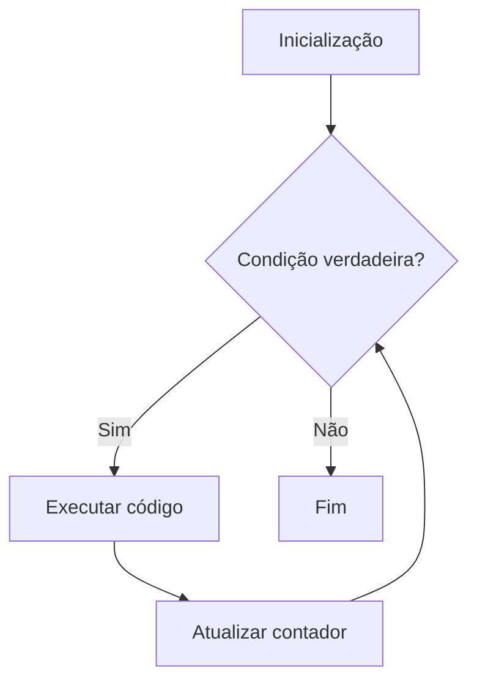

# 🔁 Laços de repetição em JavaScript

## Link da aula: https://canva.link/6q8bkutq9k32a57

## 1. O que são laços?

Os **laços de repetição (loops)** permitem executar um bloco de código várias vezes, sem precisar reescrever as mesmas instruções.

Imagine uma corrida: a cada volta, o atleta repete o percurso até atingir seu objetivo.

## 2. Elementos de um laço

- **Inicialização:** define o valor inicial da variável de controle.
- **Condição:** determina se a repetição continua.
- **Ação:** código executado a cada repetição.
- **Atualização:** altera a variável de controle.

Conforme o fluxograma da página 8 da aula:



---

## 3. Incremento e decremento

| Código | Significado |
|---|---|
| `i++` | Aumenta 1 |
| `i--` | Diminui 1 |
| `i += 2` | Aumenta 2 |
| `i -= 2` | Diminui 2 |

---

## 4. Laço `while` — enquanto

Executa um bloco de código **enquanto a condição for verdadeira**. É especialmente útil quando não sabemos antecipadamente quantas repetições serão necessárias.

```javascript
let i = 0;

while (i < 10) {
    console.log(i);
    i++;
}
```

O exemplo da página 9 apresenta quatro etapas:

1. `let i = 0`: inicialização.
2. `i < 10`: condição de continuação.
3. `console.log(i)`: ação repetida.
4. `i++`: incremento.

Quando a condição se torna falsa, o laço termina.

---

## 5. Laço `for` — para

É especialmente útil quando sabemos quantas vezes queremos repetir uma ação.

```javascript
for (let i = 0; i < 10; i++) {
    console.log(i);
}
```

```text
for (inicialização; condição; atualização)
```

O `for` reúne os três elementos de controle na mesma linha, conforme a comparação apresentada na página 33.

| `while` | `for` |
|---|---|
| Repetição controlada por uma condição | Muito utilizado em contagens |
| Inicialização geralmente antes do laço | Inicialização no cabeçalho |
| Atualização geralmente dentro do bloco | Atualização no cabeçalho |

> Ambos podem ser utilizados para contagens e outras repetições condicionais.

---

## 6. Loop infinito

Um **loop infinito** acontece quando o laço não termina.

Pode ocorrer quando esquecemos de atualizar o contador ou quando a condição nunca se torna falsa.

> ⚠️ Verifique sempre se existe uma maneira de encerrar a repetição.

---

## 7. Laços e condicionais

Podemos combinar estruturas de repetição com `if` e `else` para tomar decisões a cada repetição.

- `if/else`: permite escolher uma ação conforme uma condição.
- **Contador:** registra quantas vezes algo aconteceu.
- **Acumulador:** soma valores ao longo das repetições.
- `break`: encerra imediatamente o laço.

Esses conceitos aparecem nos desafios das páginas 37 a 39.

---

## 8. Percorrendo arrays com `while`

Um array armazena vários valores. Cada elemento possui um índice, começando em `0`.

Exemplo apresentado na página 44:

```javascript
let alunos = ["Ana", "Lucas", "Maria", "João"];
let i = 0;

while (i < alunos.length) {
    console.log(alunos[i]);
    i++;
}
```

- `i`: índice atual.
- `alunos.length`: quantidade de elementos.
- `alunos[i]`: elemento da posição atual.
- `i++`: avança para o próximo elemento.

> O último índice de um array é `length - 1`.

---

## 9. Resumo rápido

| Conceito | Função |
|---|---|
| `while` | Repetir enquanto uma condição for verdadeira |
| `for` | Organizar repetições com inicialização, condição e atualização |
| `++` | Incrementar em 1 |
| `--` | Decrementar em 1 |
| `break` | Encerrar o laço |
| `length` | Obter a quantidade de elementos de um array |

> 🧠 Antes de criar um laço, pense: onde começa, quando continua, o que repete e como termina?
